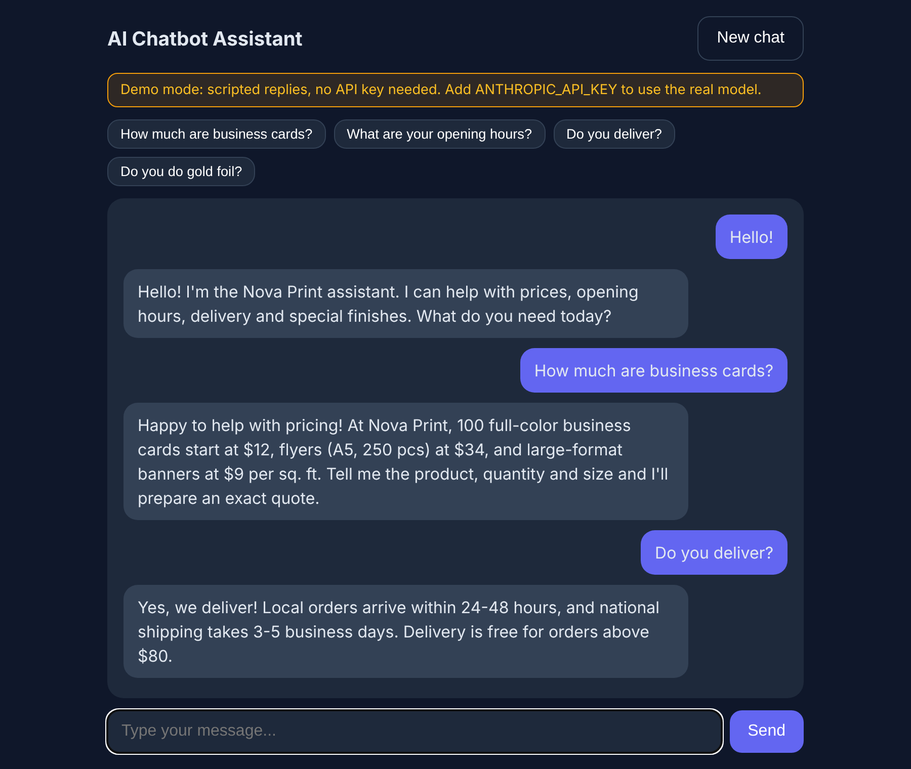

# 🤖 AI Chatbot Assistant

> A lightweight, production-style AI chatbot with **streaming replies**, **per-session memory**, and a clean web UI — built with Python, Flask and the Anthropic API.


## 🎬 Live demo (no API key needed)



> Real screenshot of the app running in **Demo mode** (scripted replies for a fictional print shop, "Nova Print").
> 👉 **Try it in your browser:** https://latouimouhamedbassim-create.github.io/ai-web-portfolio/demos/chatbot.html

---

## ✨ Features

- **Keyless Demo mode** – runs instantly with scripted replies; switches to the real Claude model as soon as you add an API key.
- **Real-time streaming** – tokens appear as they are generated, no waiting for the full answer.
- **Conversation memory** – each browser session keeps its own rolling history (last 20 messages).
- **Configurable persona** – change the assistant's role (support agent, sales assistant, FAQ bot…) with one environment variable.
- **Multilingual** – replies in the language the user writes in.
- **Zero front-end dependencies** – a single HTML file with vanilla JavaScript.
- **Safe by default** – API key loaded from `.env`, never committed.

## 🧱 Architecture

```
Browser (vanilla JS)  ──POST /api/chat──►  Flask  ──stream──►  Anthropic API
        ▲                                    │
        └───────── streamed text ◄───────────┘
                     in-memory session store
```

| File | Purpose |
|------|---------|
| `app.py` | Flask server, streaming endpoint, session memory, demo mode |
| `demo_replies.py` | Scripted replies for keyless Demo mode |
| `templates/index.html` | Chat UI |
| `.env.example` | Configuration template |

## 🚀 Quick start

```bash
git clone https://github.com/latouimouhamedbassim-create/ai-chatbot-assistant.git
cd ai-chatbot-assistant

python -m venv .venv
source .venv/bin/activate        # Windows: .venv\Scripts\activate
pip install -r requirements.txt

cp .env.example .env             # then add your ANTHROPIC_API_KEY
python app.py
```

Open **http://localhost:5000** and start chatting.

> 💡 **No API key?** Skip the `.env` step. The app automatically starts in **Demo mode** (or force it with `DEMO_MODE=1`). Demo replies are scripted and are **not** real AI output.

## ⚙️ Configuration

| Variable | Default | Description |
|----------|---------|-------------|
| `ANTHROPIC_API_KEY` | – | Your Anthropic API key (needed for real replies; optional in Demo mode) |
| `MODEL` | `claude-sonnet-4-5` | Model name to use |
| `SYSTEM_PROMPT` | support assistant | Defines the bot's personality and rules |
| `DEMO_MODE` | auto | `1` forces Demo mode (automatic when no API key) |
| `PORT` | `5000` | Server port |

## 🎯 Use cases

- Customer-support bot for a small business website
- FAQ assistant trained through the system prompt (prices, opening hours, services)
- Base for a WhatsApp / Telegram bot (reuse the `/api/chat` logic)

## 🛣️ Roadmap

- [ ] Persistent storage (SQLite / Redis) for sessions
- [ ] Knowledge-base retrieval (RAG) over PDFs
- [ ] WhatsApp Business API integration
- [ ] Docker image

## 👤 Author

**Mouhamed Bassim Latoui** – AI Developer (chatbots, agents, websites) · Constantine, Algeria
GitHub: [@latouimouhamedbassim-create](https://github.com/latouimouhamedbassim-create)

## 📄 License

MIT – free to use and adapt.
